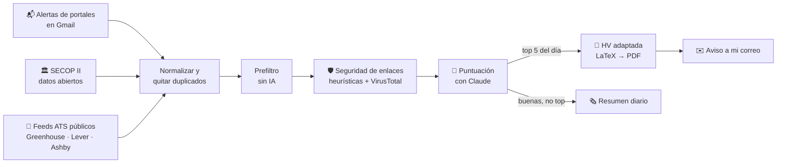

# 📡 Radar de Ofertas

**Un agente personal que vigila el mercado laboral por mí, filtra el ruido y me entrega solo las ofertas que valen la pena, con la hoja de vida ya adaptada.**

---

## El problema

Buscar trabajo bien hecho es un segundo empleo: decenas de correos de alerta al día, la mayoría irrelevantes, vacantes repetidas en cinco portales, enlaces dudosos, y una hoja de vida que habría que reescribir para cada oferta. Lo que quiero es **revisar 5 ofertas buenas al día, no 200 mediocres**.

## La solución

Un servicio que corre en mi PC, despierta cada pocos minutos, hace su trabajo y se apaga:

Y yo decido **respondiendo el correo** desde el celular: `CV`, `CV ENFOQUE datos y airflow`, `DESCARTAR`, `APLICAR`…

## Lo interesante por dentro

| | |
|---|---|
| 💸 **Económico por diseño** | La IA solo se llama cuando hay trabajo real. Lo ya leído no se vuelve a descargar, los duplicados se detectan por huella y un prefiltro determinista descarta lo viejo, lo irrelevante y lo mal pagado antes de gastar un token. Una ejecución sin novedades termina en segundos y con cero llamadas al modelo. |
| 🧠 **Dos modelos, dos trabajos** | Un modelo liviano y rápido puntúa cientos de ofertas con salida JSON validada por esquema; uno más fuerte redacta la HV y la carta solo para las pocas que lo merecen. |
| 📊 **Consciente de sus límites** | Lee en cada llamada el porcentaje de uso del plan y se pausa solo antes de agotarlo, con topes diarios configurables. |
| 🧾 **La HV nunca miente** | Un perfil maestro con evidencia es la única fuente de verdad. El adaptador solo selecciona, ordena y reformula; un validador comprueba que cada viñeta remita a su fuente y que ninguna tecnología, cifra o cargo aparezca de la nada. Lo que la oferta pide y no tengo se reporta como brecha, nunca se inventa. Hay una prueba adversaria que lo verifica. |
| 🤖 **Legible por ATS y LLM, sin trucos** | Una columna, texto 100 % extraíble, terminología espejo de la oferta solo cuando el perfil la respalda, habilidades con contexto. Nada de texto oculto ni *keyword stuffing*. |
| 🛡️ **Ningún enlace se abre** | Los enlaces de las ofertas se analizan (dominios parecidos, acortadores, TLD raros, reputación en VirusTotal con caché y limitador de cuota) y se muestran con su veredicto. Las ofertas tratan su texto como dato, nunca como instrucción. |
| 🏛️ **Datos abiertos del Estado** | Consulta la API pública de SECOP II para detectar procesos de contratación abiertos y, cada mes, genera inteligencia: qué entidades contratan perfiles de datos, cuánto pagan y en qué meses. |
| 🌐 **Bilingüe** | La HV, la carta y las respuestas sugeridas salen en el idioma de la oferta. |

## Principios

- **Cero automatización de portales.** No hay *scraping*, logins ni clics automáticos en LinkedIn, Indeed u otros portales: solo se leen los correos de alerta que ellos mismos envían, y la postulación la hago yo.
- **Nada sale sin mí.** Ningún correo a terceros se envía sin un `APLICAR` → vista previa → `CONFIRMAR` explícito. No existe un modo automático.
- **Fuentes legítimas.** APIs oficiales y páginas públicas que lo permiten en su `robots.txt`, con un User-Agent identificado.
- **Privacidad local.** Todo vive en mi máquina; los secretos y los datos personales nunca entran al repositorio.

## Stack

`Python 3.12` · `uv` · `SQLite` · `Gmail API (OAuth)` · `Claude Code headless (claude -p)` con salida estructurada · `Jinja2 + LaTeX` · `httpx` · `BeautifulSoup` · `pydantic` · `tenacity` · `typer` + `rich` · `pytest` · Programador de tareas de Windows

## Estado

- [x] Fase 0 · Esqueleto, configuración y CLI
- [x] Fase 1 · Gmail: OAuth, etiquetas, filtros automáticos, envío
- [ ] Fase 2 · Perfil maestro con evidencia y HV base (ES/EN)
- [ ] Fase 3 · Ingesta, parsers, lista negra y seguridad de enlaces
- [ ] Fase 4 · Puntuación por carriles y avisos con HV
- [ ] Fase 5 · Comandos por correo y validador de honestidad
- [ ] Fase 6 · SECOP II, feeds ATS y páginas de entidades
- [ ] Fase 7 · Programación, salud y recuperación
- [ ] Fase 8 · Postulación por correo con doble confirmación

---

El código fuente es privado porque contiene configuración personal. Este repositorio aloja la descripción pública del proyecto y su <a href="https://hdballestan.github.io/radar-ofertas-legal/privacidad.html">política de privacidad</a>.

<b>English summary</b>

**Job Radar** is a personal agent that watches the job market for me. It ingests portal alert emails (read-only, no scraping), Colombia's public procurement open data (SECOP II) and public ATS feeds; deduplicates and pre-filters without AI; checks every link's safety without opening it; scores the survivors with Claude using schema-validated JSON; and emails me only the top 5 of the day with a one-page résumé tailored to each offer, generated from an evidence-backed master profile and checked by a validator that forbids invented skills. I act by replying to the email. Nothing is ever sent to a third party without my explicit two-step confirmation.

