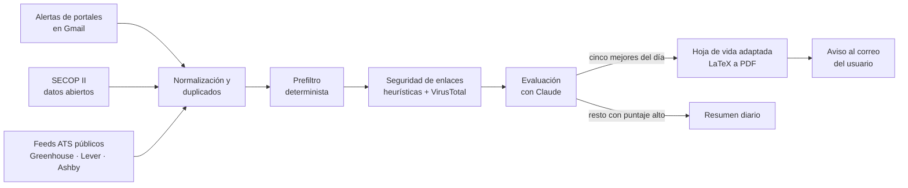

# Radar de Ofertas

**Agente personal que filtra ofertas de empleo, descarta lo irrelevante y entrega solo las mejores, cada una con una hoja de vida adaptada a partir de un perfil con evidencia.**

---

## Problema

Las alertas de empleo llegan por decenas cada día desde varios portales. La mayoría no encaja con el perfil, muchas vacantes se repiten, algunos enlaces son dudosos y cada postulación exige adaptar la hoja de vida. El objetivo es reducir ese volumen a un máximo de cinco ofertas diarias de buena calidad, listas para decidir.

## Funcionamiento

El servicio se ejecuta en un equipo local mediante tareas programadas. Cada ejecución procesa lo nuevo y termina.

El usuario responde al correo de aviso con comandos como `CV`, `CV ENFOQUE <tema>`, `DESCARTAR` o `APLICAR`.

## Decisiones técnicas

| Aspecto | Implementación |
|---|---|
| **Costo controlado** | El modelo solo se invoca cuando hay trabajo. Los correos procesados se etiquetan y no se vuelven a descargar, los duplicados se detectan por huella y un prefiltro determinista descarta ofertas antiguas, irrelevantes o por debajo del rango salarial antes de cualquier llamada. Una ejecución sin novedades termina en segundos y sin consumo de modelo. |
| **Dos modelos** | Un modelo liviano evalúa las ofertas con salida JSON validada por esquema. Un modelo más capaz redacta la hoja de vida y la carta solo para las ofertas seleccionadas. |
| **Límites de uso** | Cada llamada informa el porcentaje consumido del plan. El servicio avisa y se detiene antes de alcanzar los umbrales configurados, además de respetar topes diarios propios. |
| **Hoja de vida verificable** | Un perfil maestro con evidencia es la única fuente de datos. El adaptador selecciona, ordena y reformula; un validador comprueba que cada viñeta remita a su fuente y que no aparezcan tecnologías, cargos ni cifras ausentes del perfil. Los requisitos no cubiertos se reportan como brechas. Una prueba adversaria verifica este comportamiento. |
| **Lectura por ATS y LLM** | Una columna, texto extraíble, terminología alineada con la oferta solo cuando el perfil la respalda y habilidades presentadas con contexto. Sin texto oculto ni listas de palabras clave. |
| **Enlaces sin abrir** | Los enlaces se analizan sin visitarlos: dominios similares a marcas conocidas, acortadores, dominios de nivel superior inusuales y reputación en VirusTotal, con caché y control de cuota. El texto de las ofertas se trata como dato, nunca como instrucción. |
| **Datos abiertos** | La API pública de SECOP II permite detectar procesos de contratación abiertos y generar un informe mensual sobre entidades contratantes, honorarios y estacionalidad. |
| **Bilingüe** | La hoja de vida, la carta y las respuestas sugeridas se generan en el idioma de la oferta. |

## Principios

- **Sin automatización de portales.** No hay extracción de contenido, inicio de sesión ni acciones automáticas en portales de empleo. Solo se leen los correos de alerta que esos portales envían; la postulación la realiza el usuario.
- **Supervisión obligatoria.** Ningún correo a terceros sale sin la secuencia `APLICAR`, vista previa y `CONFIRMAR`. No existe un modo automático.
- **Fuentes legítimas.** APIs oficiales y páginas públicas que lo permiten en su `robots.txt`, con un agente de usuario identificado.
- **Datos locales.** La información se procesa en el equipo del usuario. Credenciales y datos personales no forman parte de ningún repositorio.

## Stack

`Python 3.12` · `uv` · `SQLite` · `Gmail API (OAuth)` · `Claude Code (modo headless)` con salida estructurada · `Jinja2 + LaTeX` · `httpx` · `BeautifulSoup` · `pydantic` · `tenacity` · `typer` · `rich` · `pytest` · Programador de tareas de Windows

## Avance

- [x] Fase 0. Estructura, configuración y CLI
- [x] Fase 1. Gmail: OAuth, etiquetas, filtros y envío
- [x] Fase 2. Perfil maestro con evidencia y hoja de vida base en español e inglés
- [ ] Fase 3. Ingesta, extractores, lista de exclusión y seguridad de enlaces
- [ ] Fase 4. Evaluación por modalidad de contratación y avisos
- [ ] Fase 5. Comandos por correo y validador de la hoja de vida
- [ ] Fase 6. SECOP II, feeds ATS y páginas institucionales
- [ ] Fase 7. Programación, monitoreo y recuperación
- [ ] Fase 8. Postulación por correo con doble confirmación

---

El código fuente es privado porque contiene configuración personal. Este repositorio publica la descripción del proyecto y su <a href="https://hdballestan.github.io/radar-ofertas-legal/privacidad.html">política de privacidad</a>.

<b>English summary</b>

**Radar de Ofertas** is a personal job-search agent. It reads job-alert emails sent by portals (no scraping), Colombia's public procurement open data (SECOP II) and public ATS feeds. It deduplicates and pre-filters offers deterministically, assesses link safety without visiting any link, scores the remaining offers with Claude using schema-validated JSON, and emails its single user at most five offers per day, each with a one-page résumé tailored from an evidence-backed master profile. A validator rejects any skill, title or figure not present in that profile. Nothing is sent to a third party without explicit two-step confirmation.

